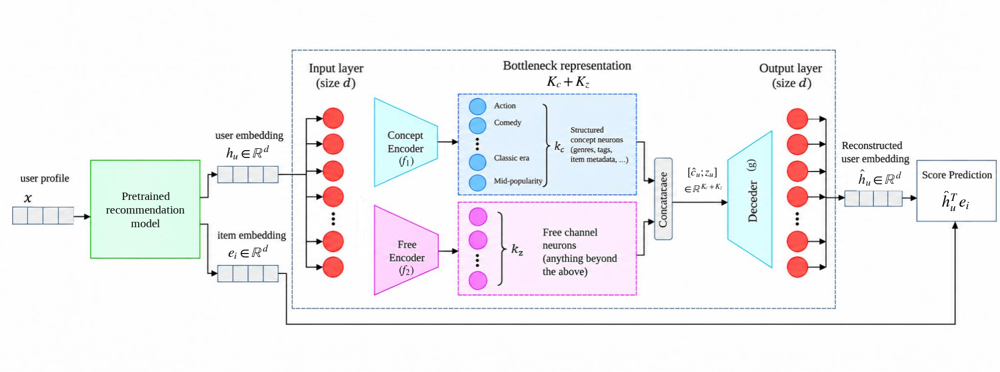

# ConceptRec

**Steerable and Interpretable Recommendation via Post-Hoc Concept Bottlenecks**

This repository contains the code for **ConceptRec**, a post-hoc framework for interpreting and steering pretrained recommender systems. ConceptRec combines metadata-supervised concepts with an unsupervised free channel to preserve recommendation quality while enabling targeted concept amplification and suppression.

## Framework

<p align="center">
  
</p>

<p align="center">
  <em>Overview of the ConceptRec framework.</em>
</p>


## Environment Setup

Create and activate a Python virtual environment:

```bash
python3 -m venv conceptrec-env
source conceptrec-env/bin/activate
```

Install the required dependencies:

```bash
pip install -r requirements.txt
```

To deactivate the environment:

```bash
deactivate
```

## Experiments

- **Datasets:** MovieLens 1M (ML-1M), BeerAdvocate, and LastFM.
- **Backbones:** SASRec and LightGCN.
- **Baselines:** IaSAE and RecSAE.
- **Evaluation:** nDCG@10, RBO@10, representation similarity, concept alignment, and Push-Pull steering.

The repository covers concept construction, model training, and evaluation for the experiments reported in the paper.
